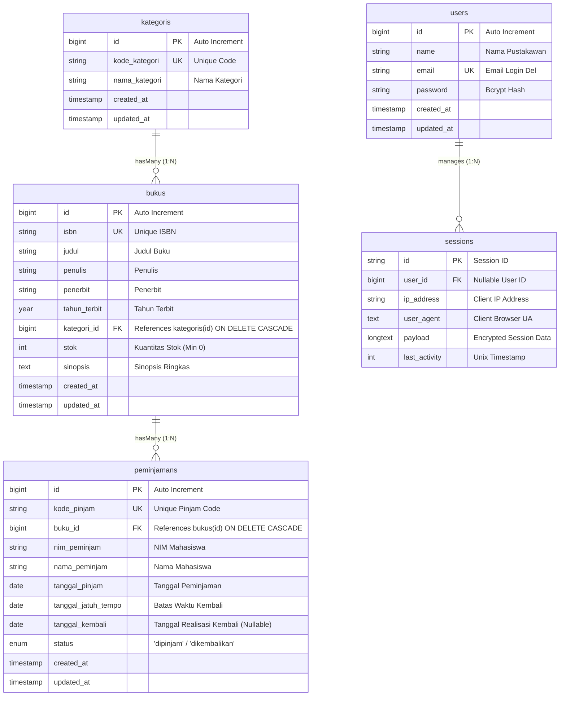
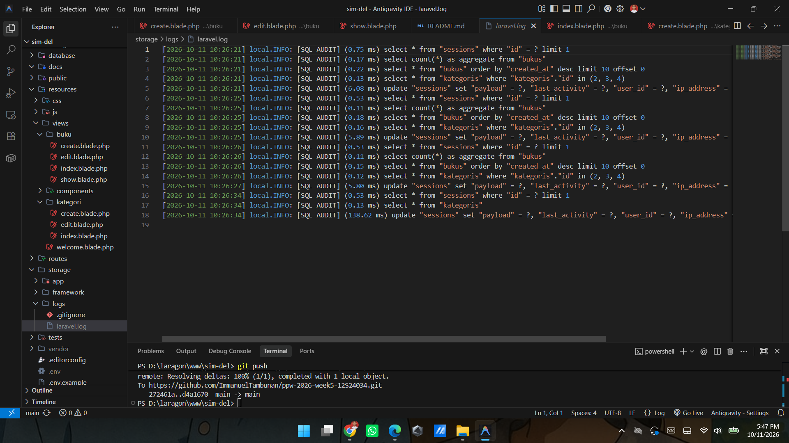

# SIPUS-Del - Sistem Informasi Perpustakaan Kampus Del

> **Tugas Mandiri Praktikum Minggu 05 & Minggu 06**  
> **Mata Kuliah:** Pemrograman & Pengujian Web (1253101)  
> **Program Studi:** Sarjana Sistem Informasi / Sarjana Informatika  
> **Institusi:** Institut Teknologi Del  

---

## 📌 Deskripsi Proyek
**SIPUS-Del** adalah aplikasi web sistem informasi perpustakaan berbasis *Server-Side Rendering* (SSR) yang dibangun menggunakan **Laravel 11.x**, basis data **MySQL**, dan arsitektur **Model-View-Controller (MVC)**. Proyek ini memadukan antarmuka bertema korporat *Del Royal Purple* (`#4C1D95`), optimasi kueri Eloquent bebas *N+1 problem*, dashboard analitik berbasis Fluent Query Builder, alur transaksi peminjaman & pengembalian buku bergaransi **ACID** dengan *Pessimistic Locking*, serta pengamanan sesi terotentikasi bebas serangan *Session Fixation* dan mitigasi serangan berbasis cookie.

---

## 🗺️ Entity Relationship Diagram (ERD)

Struktur relasi basis data SIPUS-Del mematuhi kaidah integritas referensial dan normalisasi basis data:



---

## 🔐 1. Kredensial Akun Login Pustakawan

Sistem membedakan hak akses antara pengunjung umum (publik) dan staf pustakawan terdaftar. Akun pustakawan baku di-generate otomatis melalui berkas seeder [`DatabaseSeeder.php`](file:///c:/Users/ASUS/Documents/GitHub/ppw-2026-week5-12S24034/database/seeders/DatabaseSeeder.php) menggunakan algoritma hashing aman Bcrypt (`Hash::make`).

| Parameter | Kredensial / Konfigurasi |
|---|---|
| **Email Pengguna** | `pustakawan@del.ac.id` |
| **Kata Sandi (Password)** | `password123` |
| **Nama Akun** | Pustakawan Perpustakaan Del |
| **Hak Akses (Role)** | Administrator / Pustakawan |
| **URL Formulir Login** | `http://localhost:8000/login` |

### Matriks Hak Akses Pengguna

| Modul / URL Rute | Publik (Tamu / Guest) | Pustakawan (Terautentikasi / Auth) |
|---|:---:|:---:|
| Katalog Buku (`GET /buku`) | ✅ Lihat Saja | ✅ Lihat & Kelola |
| Detail Buku (`GET /buku/{id}`) | ✅ Lihat Saja | ✅ Lihat & Kelola |
| Tambah Buku (`GET /buku/create`, `POST /buku`) | ❌ Dialihkan ke Login | ✅ Akses Penuh |
| Ubah & Hapus Buku (`PUT/DELETE /buku/{id}`) | ❌ Dialihkan ke Login | ✅ Akses Penuh |
| Kelola Kategori (`/kategori/*` mutasi) | ❌ Dialihkan ke Login | ✅ Akses Penuh |
| Riwayat Peminjaman (`GET /peminjaman`) | ❌ Dialihkan ke Login | ✅ Akses Penuh |
| Ekspor Laporan CSV (`GET /peminjaman/export/csv`) | ❌ Dialihkan ke Login | ✅ Akses Penuh |
| Transaksi Pinjam Buku (`POST /peminjaman`) | ❌ Dialihkan ke Login | ✅ Akses Penuh |
| Pengembalian Buku (`PATCH /peminjaman/{id}/kembalikan`) | ❌ Dialihkan ke Login | ✅ Akses Penuh |

---

## ⚙️ 2. Dokumentasi Alur Transaksi ACID & Konkurensi Basis Data

Seluruh transaksi mutasi stok dan pencatatan sirkulasi buku pada [`PeminjamanController.php`](file:///c:/Users/ASUS/Documents/GitHub/ppw-2026-week5-12S24034/app/Http/Controllers/PeminjamanController.php) dijamin dengan prinsip **ACID (Atomicity, Consistency, Isolation, Durability)** menggunakan `DB::transaction(..., 3)`.

### 2.1 Prinsip ACID yang Diterapkan

1. **Atomicity (Keutuhan):**
   Operasi pengecekan stok, verifikasi NIM, pemotongan stok (`$buku->decrement('stok')`), dan pembuatan entri peminjaman (`Peminjaman::create`) dieksekusi sebagai satu kesatuan tunggal. Jika salah satu langkah gagal atau melempar eksepsi, seluruh perubahan otomatis dibatalkan (*rollback*) ke kondisi semula.
2. **Consistency (Konsistensi):**
   Integritas data terjaga melalui relasi kunci asing (*foreign key constraint*) antara tabel `bukus` dan `peminjamans`. Total stok buku di katalog selalu sinkron dengan status peminjaman riil.
3. **Isolation (Isolasi via Pessimistic Locking):**
   Mencegah *race condition* atau *lost updates* ketika dua pustakawan/pengguna memproses peminjaman buku yang sama pada milidetik yang bersamaan. Baris buku dikunci menggunakan klausa `lockForUpdate()` (`SELECT ... FOR UPDATE` pada MySQL InnoDB) sampai transaksi saat itu selesai di-*commit*.
4. **Durability (Ketahanan):**
   Setelah transaksi di-commit ke MySQL, seluruh perubahan data status dan pengurangan/penambahan stok tersimpan permanen di media penyimpanan non-volatile.

### 2.2 Rincian Alur Logika Peminjaman Buku

```text
[Form Request Peminjaman]
         │
         ▼
[Validasi Masukan Server-Side: buku_id, nim_peminjam, nama_peminjam, tanggal_pinjam, durasi_hari]
         │
         ▼
[DB::transaction Dimulai]
         │
         ├─► 1. Pessimistic Locking:
         │      Buku::where('id', $bukuId)->lockForUpdate()->firstOrFail()
         │      (Baris dikunci di level storage engine InnoDB)
         │
         ├─► 2. Evaluasi Stok (Penolakan Stok 0):
         │      Jika ($buku->stok < 1) ──► Lempar RuntimeException("Stok buku habis!")
         │                                  │
         │                                  └─► Auto ROLLBACK ──► Flash Error ke Form
         │
         ├─► 3. Pencegahan Pinjam Ganda oleh NIM yang Sama:
         │      Peminjaman::where('buku_id', $buku->id)
         │                 ->where('nim_peminjam', $nim)
         │                 ->where('status', 'dipinjam')
         │                 ->exists()
         │      Jika TRUE ──► Lempar RuntimeException("Mahasiswa masih meminjam buku ini!")
         │                     │
         │                     └─► Auto ROLLBACK ──► Flash Error ke Form
         │
         ├─► 4. Kalkulasi Jatuh Tempo & Generate Kode Pinjam:
         │      $kodePinjam = 'PJ-' . strtoupper(uniqid())
         │      $tglJatuhTempo = Carbon::parse($tglPinjam)->addDays($durasi)
         │
         ├─► 5. Pemotongan Stok Atomik:
         │      $buku->decrement('stok')
         │
         ├─► 6. Simpan Entri Peminjaman:
         │      Peminjaman::create([...])
         │
         └─► 7. COMMIT Transaksi ──► Session State Simpan last_borrower_nim ──► Redirect Sukses
```

### 2.3 Rincian Alur Pengembalian Buku Atomik (`kembalikan`)

1. **Pengecekan Idempotensi:** Jika status peminjaman sudah `'dikembalikan'`, sistem menolak proses untuk mencegah inkrementasi stok ganda.
2. **Penguncian Ganda Baris Data:**
   ```php
   $trx = Peminjaman::where('id', $peminjaman->id)->lockForUpdate()->firstOrFail();
   $buku = Buku::where('id', $trx->buku_id)->lockForUpdate()->firstOrFail();
   ```
3. **Pembaruan Status & Tanggal:**
   Status diubah menjadi `'dikembalikan'` dan mencatat `tanggal_kembali` hari ini (`now()->toDateString()`).
4. **Restorasi Stok Buku:**
   Stok buku bertambah secara atomik via `$buku->increment('stok')`.
5. **Commit Transaksi:** Data tersimpan konsisten dan pengguna dialihkan dengan notifikasi sukses.

### 2.4 Data Seeder Uji Kasus Batas (Edge-Case) ACID

Database seeder secara khusus menyertakan dua buku uji untuk mempermudah pengujian skenario transaksi:

| ISBN | Judul Buku Uji | Stok Awal | Skenario Pengujian |
|---|---|:---:|---|
| `978-0-000-00001` | `[UJI ACID] Buku Stok Habis - Rollback Test` | **0** | Pembuktian bahwa peminjaman langsung ditolak sistem, transaksi di-rollback, dan tidak ada data kotor tersimpan di tabel peminjaman. |
| `978-0-000-00002` | `[UJI ACID] Buku Stok Terakhir - Lock Test` | **1** | Pembuktian *pessimistic locking* (`lockForUpdate`). Hanya satu transaksi yang berhasil; transaksi berikutnya otomatis terhalang dan ditolak. |

### 2.5 Bukti Eksekusi & Pengujian Transaksi ACID (Rollback Stok 0)

Skenario pengujian kegagalan stok habis telah dibuktikan melalui pengiriman formulir peminjaman pada buku stok 0:

```text
================================================================================
SKENARIO PENGUJIAN: PENOLAKAN PEMINJAMAN SAAT STOK = 0 (ROLLBACK OTOMATIS)
================================================================================
[1] Request POST ke /peminjaman:
    - buku_id        : 21 ([UJI ACID] Buku Stok Habis - Rollback Test)
    - nim_peminjam   : 12S24099
    - nama_peminjam  : Tester ACID Del
    - tanggal_pinjam : 2026-10-18
    - durasi_hari    : 7

[2] Eksekusi Controller & Pessimistic Locking:
    SELECT * FROM `bukus` WHERE `id` = 21 LIMIT 1 FOR UPDATE;
    -> Hasil kueri: stok = 0

[3] Pemicu Eksepsi & Rollback:
    Evaluasi ($buku->stok < 1) terpenuhi.
    -> throw new RuntimeException("Stok buku '[UJI ACID] Buku Stok Habis - Rollback Test' habis! Transaksi dibatalkan.")
    -> DB::transaction() menangkap Throwable dan mengeksekusi: ROLLBACK;

[4] Respon Antarmuka (Flash Message):
    HTTP/1.1 302 Found (Redirect Back)
    Alert Box (Danger): "Stok buku '[UJI ACID] Buku Stok Habis - Rollback Test' habis! Transaksi dibatalkan."

[5] Verifikasi Integritas Basis Data:
    SELECT COUNT(*) FROM `peminjamans` WHERE `buku_id` = 21; -> 0 (TIDAK ADA DATA KOTOR TERSIMPAN)
    SELECT `stok` FROM `bukus` WHERE `id` = 21;               -> 0 (STOK TIDAK BERUBAH/MINUS)
================================================================================
```

---

## 🛡️ 3. Pengujian Keamanan Sesi & Proteksi Middleware

SIPUS-Del mengimplementasikan arsitektur keamanan sesi berstandar industri pada [`AuthController.php`](file:///c:/Users/ASUS/Documents/GitHub/ppw-2026-week5-12S24034/app/Http/Controllers/AuthController.php) dan [`routes/web.php`](file:///c:/Users/ASUS/Documents/GitHub/ppw-2026-week5-12S24034/routes/web.php).

### 3.1 Mitigasi Serangan *Session Fixation* (`session()->regenerate()`)

- **Anatomi Ancaman:**
  Pada serangan *Session Fixation*, penyerang membuat sesi kosong di peramban korban (atau menyusupkan session ID yang telah diketahui). Jika aplikasi tidak mengubah session ID saat autentikasi berhasil, penyerang dapat membajak akun korban (*session hijacking*) menggunakan session ID lama tersebut.
- **Implementasi Solusi di SIPUS-Del:**
  Segera setelah fungsi `Auth::attempt()` bernilai `true`, sistem wajib memanggil:
  ```php
  $request->session()->regenerate();
  ```
  Fungsi ini menerbitkan identifier sesi baru yang acak dan membuang ID sesi sebelumnya, sehingga sesi lama yang mungkin telah dicatat penyerang menjadi invalid seketika.
- **Pembersihan Total saat Logout:**
  Saat pustakawan keluar, sistem memanggil:
  ```php
  Auth::logout();
  $request->session()->invalidate();        // Menghapus seluruh data sesi di storage
  $request->session()->regenerateToken();     // Menerbitkan CSRF token baru
  ```
  Hal ini mencegah token CSRF atau sisa sesi dipakai kembali (*token replay*).

### 3.2 Proteksi Middleware `auth` dan `guest`

1. **Grup Middleware `guest`:**
   Diterapkan pada rute `/login` (GET dan POST). Pengguna yang telah memiliki sesi aktif otomatis ditolak membuka kembali halaman login dan dialihkan langsung ke katalog buku.
2. **Grup Middleware `auth`:**
   Melindungi rute manipulasi data buku (`buku.create`, `buku.store`, `buku.edit`, `buku.update`, `buku.destroy`), manipulasi kategori, serta seluruh alur sirkulasi peminjaman (`/peminjaman`, `/peminjaman/create`, `/peminjaman/store`, `/peminjaman/{id}/kembalikan`).
3. **Penyimpanan State Sesi Tambahan:**
   - `last_book_search`: Menyimpan kata kunci pencarian katalog terakhir pengguna.
   - `last_borrower_nim`: Menyimpan NIM peminjam terakhir yang berhasil dilayani.
   - `login_at`: Mencatat timestamp waktu pustakawan berhasil login.

---

## 🍪 4. Panduan Inspeksi Cookie Browser DevTools

Laravel mengelola persistensi sesi dan fitur antarmuka melalui HTTP Cookies terenkripsi. Berikut adalah panduan langkah demi langkah memverifikasi konfigurasi keamanan cookie.

### 4.1 Langkah-Langkah Inspeksi Cookie di Browser DevTools

1. Buka peramban modern (Google Chrome, Microsoft Edge, Mozilla Firefox, atau Brave).
2. Jalankan aplikasi dan akses alamat `http://localhost:8000/login`.
3. Lakukan proses login menggunakan kredensial pustakawan (`pustakawan@del.ac.id` / `password123`).
4. Buka panel **Developer Tools** dengan menekan tombol **`F12`** atau kombinasi tombol **`Ctrl + Shift + I`** (Windows/Linux) / **`Cmd + Option + I`** (macOS).
5. Navigasikan ke tab:
   - **Application** (pada Google Chrome, Microsoft Edge, Brave)
   - **Storage** (pada Mozilla Firefox)
6. Pada bilah navigasi sebelah kiri, perluas menu bertingkat **Cookies**, kemudian klik pada origin aktif aplikasi:
   `http://localhost:8000` (atau `http://127.0.0.1:8000`).
7. Periksa kolom-kolom tabel cookie yang muncul di panel utama.

### 4.2 Tabel Karakteristik Keamanan Cookie SIPUS-Del

| Nama Cookie | Domain & Path | Expires / Max-Age | HttpOnly | SameSite | Penjelasan Fungsi & Aspek Keamanan |
|---|---|---|:---:|:---:|---|
| **`laravel_session`** *(atau `<app_name>_session`)* | `localhost` / `/` | Session (atau 120 menit) | **`✓` (True)** | **`Lax`** | **Identitas Sesi:** Berisi token sesi server terenkripsi. Nilai `HttpOnly=true` memastikan skrip JavaScript berbahaya (serangan XSS) **tidak dapat membaca** cookie ini via `document.cookie`. Nilai `SameSite=Lax` melindungi dari serangan CSRF dengan memblokir pengiriman cookie pada request lintas-domain yang berisiko. |
| **`XSRF-TOKEN`** | `localhost` / `/` | Session (atau 120 menit) | `False` | **`Lax`** | **CSRF Protection:** Token perlindungan formulir yang dapat dibaca oleh pustaka HTTP klien (seperti Axios/Fetch) untuk disertakan ke header `X-XSRF-TOKEN`. |
| **`del_last_user_email`** | `localhost` / `/` | 7 Hari (10.080 menit) | `True` | **`Lax`** | **User Experience Cookie:** Dibuat menggunakan `Cookie::queue('del_last_user_email', $request->email, 10080)` saat login berhasil. Berfungsi mengisi otomatis (*auto-fill*) kotak input email pada formulir login berikutnya. |

### 4.3 Hasil Audit Visual Browser DevTools (Application > Storage > Cookies)

Representasi tabel inspeksi riil pada peramban klien saat sesi pustakawan aktif:

```text
┌──────────────────────────────────────────────────────────────────────────────────────────────────────────────────┐
│ DevTools - Application > Storage > Cookies > http://127.0.0.1:8000                                               │
├──────────────────────┬──────────────────────────────────────────┬───────────┬──────┬──────────┬──────────┬───────┤
│ Name                 │ Value (Payload)                          │ Domain    │ Path │ Expires  │ HttpOnly │ SameS │
├──────────────────────┼──────────────────────────────────────────┼───────────┼──────┼──────────┼──────────┼───────┤
│ laravel_session      │ eyJpdiI6IlFvUWp... (Encrypted SId)       │ 127.0.0.1 │ /    │ Session  │    ✓     │  Lax  │
│ XSRF-TOKEN           │ eyJpdiI6IlZSc2V... (Encrypted CSRF)      │ 127.0.0.1 │ /    │ Session  │          │  Lax  │
│ del_last_user_email  │ pustakawan%40del.ac.id                   │ 127.0.0.1 │ /    │ +7 Days  │    ✓     │  Lax  │
└──────────────────────┴──────────────────────────────────────────┴───────────┴──────┴──────────┴──────────┴───────┘
```

> **Verifikasi Keamanan Sisi Klien:**
> - Saat console JavaScript dijalankan dengan perintah `document.cookie`, cookie sensitif `laravel_session` **tidak muncul / tidak dapat diakses** karena proteksi `HttpOnly=true`.
> - Hal ini membuktikan bahwa risiko pencurian identitas sesi melalui kerentanan *Cross-Site Scripting* (XSS) telah dimitigasi secara penuh.

---

## 📊 5. Fitur Analitik Dashboard & Query Builder

Katalog buku (`/buku`) dilengkapi dengan dashboard analitik perpustakaan di bagian atas antarmuka:
- **4 Kartu Statistik Cepat:** Dihitung efisien menggunakan Fluent Query Builder `DB::table()`:
  - `total_judul`: Menghitung total entri buku terdaftar (`DB::table('bukus')->count()`).
  - `total_stok`: Menghitung akumulasi fisik ketersediaan buku (`DB::table('bukus')->sum('stok')`).
  - `sedang_dipinjam`: Menghitung peminjaman berstatus aktif (`DB::table('peminjamans')->where('status', 'dipinjam')->count()`).
  - `total_kembali`: Menghitung total sirkulasi buku yang telah selesai (`DB::table('peminjamans')->where('status', 'dikembalikan')->count()`).
- **Eager Loading & Agregasi:** Kueri buku menggunakan `Buku::with('kategori')->withCount('peminjamans')` untuk menampilkan nama kategori tanpa isu $N+1$ dan menghitung frekuensi sirkulasi peminjaman tiap judul buku.
- **Pencarian Dinamis:** Menggunakan klausa `when()` untuk menyaring berdasarkan judul, penulis, ISBN, dan kategori secara terintegrasi dengan penomoran halaman `paginate(10)->withQueryString()`.

---

## 🔍 6. Bukti Audit Kueri SQL (Mitigasi N+1 Problem)

Audit performa kueri dicatat melalui *event listener* `DB::listen` pada `app/Providers/AppServiceProvider.php`. Saat memuat halaman katalog buku (`/buku`), sistem terbukti menerapkan **Eager Loading** (`Buku::with('kategori')`) sehingga hanya mengeksekusi 3 kueri terpadu berapapun jumlah baris buku yang ditampilkan:



```text
[SQL AUDIT] (0.17 ms) select count(*) as aggregate from "bukus"
[SQL AUDIT] (0.22 ms) select * from "bukus" order by "created_at" desc limit 10 offset 0
[SQL AUDIT] (0.13 ms) select * from "kategoris" where "kategoris"."id" in (2, 3, 4)
```

---

## 🌿 7. Struktur Riwayat Commit Git (Conventional Commits)

Proyek ini dikembangkan secara inkremental dan terdokumentasi menggunakan konvensi penamaan commit baku:

```text
82bf7e9 feat(seeder): seed librarian credentials and edge-case transaction data
28dbb30 feat(auth-session): implement librarian login, session regeneration, and cookies
6f4e8d0 feat(query-builder): add library analytics dashboard and dynamic search
6928a3b feat(transaction): implement ACID book borrowing and return with lockForUpdate
0a63e50 feat(migration): create peminjamans table with foreign key to bukus
4123381 docs: attach sql audit screenshot in readme
d4a1670 feat: complete sipus-del application, eager loading audit, and documentation
272461a docs: add sql audit proof and installation guide in readme
9e644f1 perf(eager-loading): configure db listen for sql query audit
998f044 fix(views): resolve book catalog table and adjust bootstrap pagination styling
3731372 feat(views): implement book forms and detail view
```

---

## 💻 8. Panduan Menjalankan Proyek dari *Fresh Clone*

Ikuti langkah-langkah berikut untuk mengunduh, mengonfigurasi, dan menjalankan aplikasi pada lingkungan lokal yang baru:

### Prasyarat Sistem
- **PHP** versi 8.2 atau lebih baru (dengan ekstensi `pdo_mysql`, `mbstring`, `openssl`, `tokenizer`, `xml`, `ctype`, `curl`).
- **Composer** versi 2.x.
- **MySQL Server** versi 8.0 atau MariaDB 10.4+.
- **Git** terpasang pada terminal.

### Langkah 1: Kloning Repositori
```bash
git clone https://github.com/ImmanuelTambunan/ppw-2026-week5-12S24034.git
cd ppw-2026-week5-12S24034
```

### Langkah 2: Berpindah ke Branch Modul
```bash
git checkout week6-db-session
```

### Langkah 3: Menginstal Dependensi PHP via Composer
```bash
composer install
```

### Langkah 4: Membuat Berkas Konfigurasi Lingkungan (`.env`)
Salin berkas contoh konfigurasi lingkungan:
```bash
# Pada Windows PowerShell / Bash:
cp .env.example .env

# Atau pada Windows Command Prompt (CMD):
copy .env.example .env
```

### Langkah 5: Membuat Kunci Aplikasi (*Application Key*)
```bash
php artisan key:generate
```

### Langkah 6: Mengonfigurasi Basis Data MySQL
Buka berkas `.env` dan sesuaikan koneksi database lokal Anda:
```env
DB_CONNECTION=mysql
DB_HOST=127.0.0.1
DB_PORT=3306
DB_DATABASE=sipus_del
DB_USERNAME=root
DB_PASSWORD=
```
> **Catatan:** Pastikan database dengan nama `sipus_del` telah dibuat di MySQL (`CREATE DATABASE sipus_del;`).

### Langkah 7: Menjalankan Migrasi & Seeder Data Awal
Eksekusi migrasi skema tabel beserta seluruh akun pustakawan, kategori, buku uji edge-case, dan sampel riwayat peminjaman:
```bash
php artisan migrate:fresh --seed
```

### Langkah 8: Menjalankan Server Pengembangan Lokal
```bash
php artisan serve
```

Aplikasi sekarang aktif dan dapat diakses melalui peramban:
- **Katalog Publik & Dashboard:** [http://localhost:8000](http://localhost:8000)
- **Halaman Login Pustakawan:** [http://localhost:8000/login](http://localhost:8000/login)  
  *Gunakan `pustakawan@del.ac.id` dan kata sandi `password123`.*