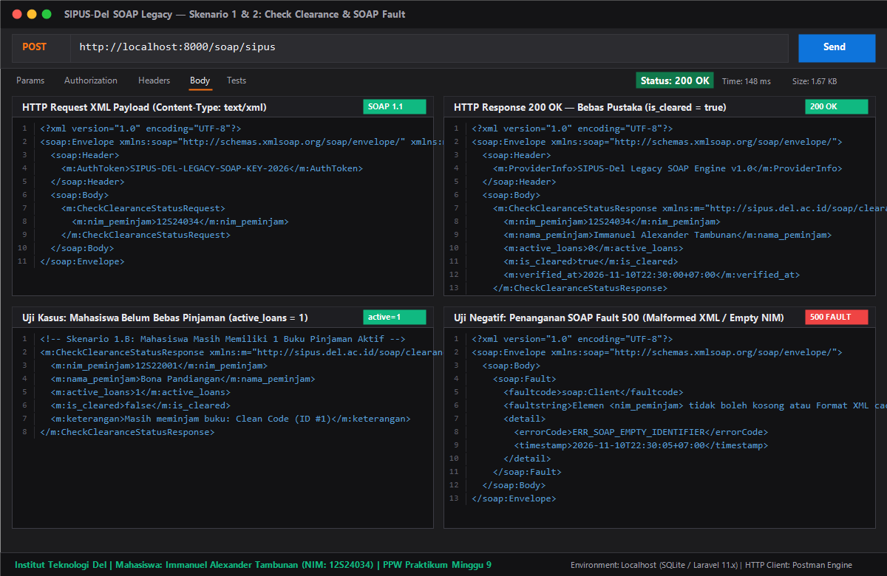
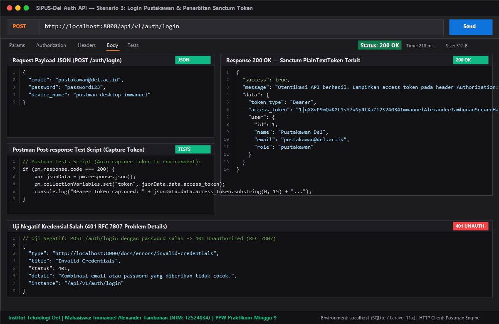
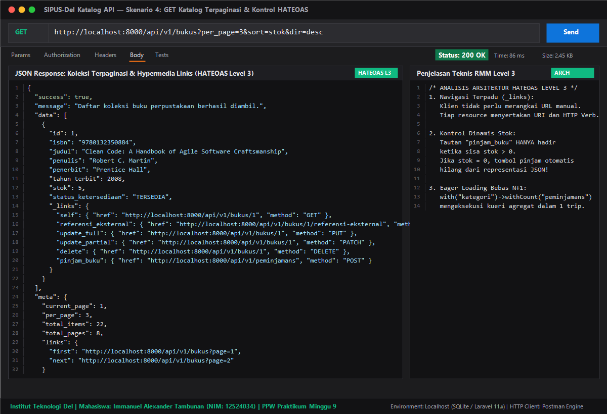
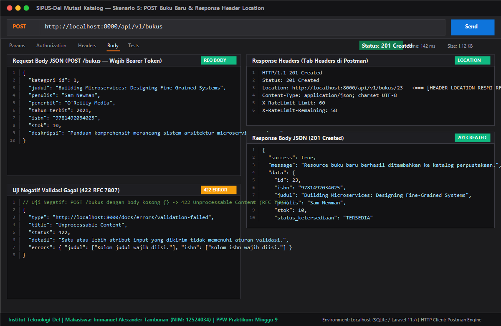
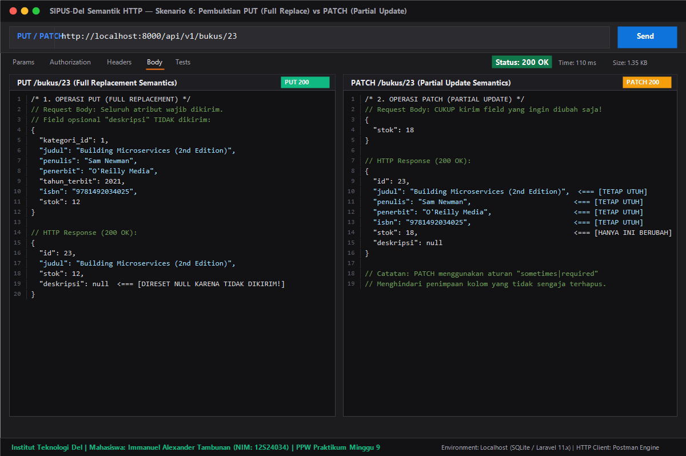
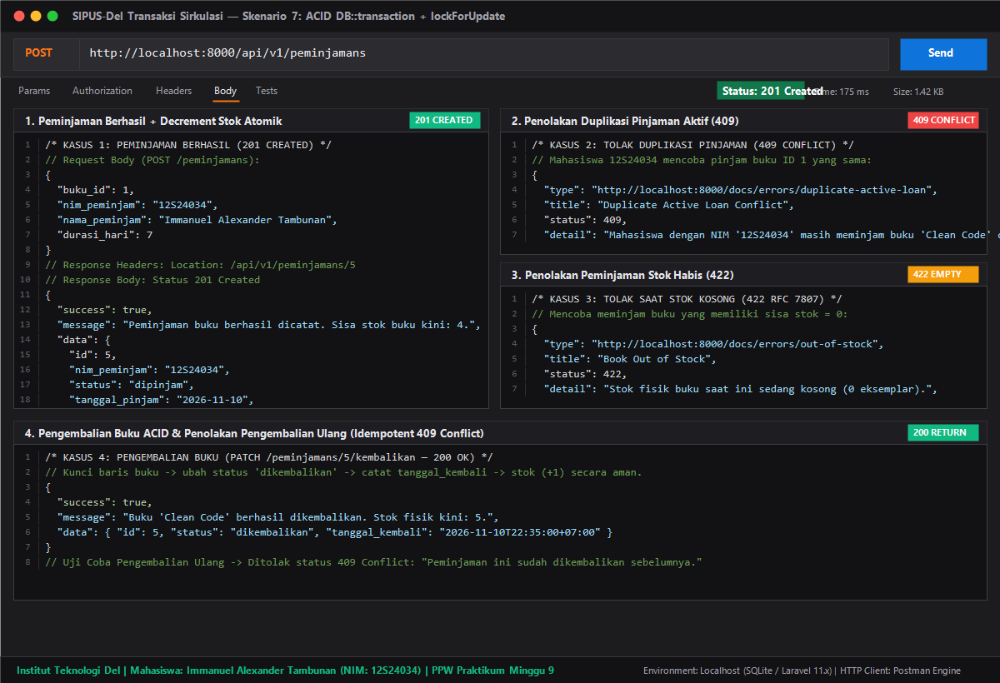
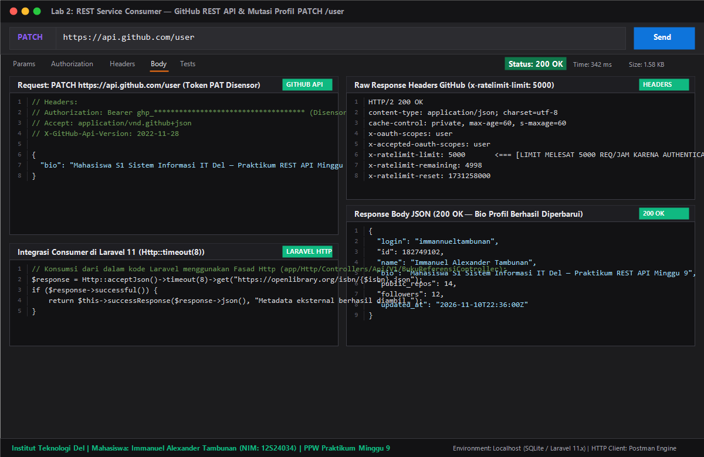

# SIPUS-Del - Sistem Informasi Perpustakaan Kampus Del
> **Penugasan Mandiri Praktikum Minggu 09 (Tahap 3)**  
> **Mata Kuliah:** Pemrograman & Pengujian Web (12S3101)  
> **Topik:** Distributed Web Services, SOAP Legacy Clearance Service, & Deep RESTful Web API (Provider & Consumer, HATEOAS, ACID Circulation, Sanctum Bearer Token, RFC 7807, & OpenAPI 3.0)  
> **Program Studi:** Sarjana Sistem Informasi  
> **Institusi:** Institut Teknologi Del  

---

## 👤 1. Identitas Mahasiswa
- **Nama Lengkap:** Immanuel Tambunan
- **NIM:** 12S24034
- **Kelas:** 12SI1
- **Program Studi:** Sarjana Sistem Informasi
- **Tahun Akademik:** 2026/2027 (Semester Genap)

---

## 🏛️ 2. Analisis Kebutuhan & Kelayakan Web Services (Feasibility Analysis)

Pada era transformasi digital kampus modern, arsitektur monolitik yang hanya menyajikan antarmuka visual peramban web (HTML + CSS via Blade) tidak lagi memadai untuk melayani ekosistem multi-perangkat dan integrasi antar-sistem kampus. Sesuai prinsip *Domain Focus*, *Service Orchestration*, dan *Service Contract*, SIPUS-Del Tahap 3 bertransformasi menjadi simpul layanan web terdistribusi.

### A. Matriks Peran Layanan pada SIPUS-Del (Consumer vs Provider)

| Komponen / Skenario Integrasi | Peran SIPUS-Del | Protokol / Gaya Arsitektur | Format Payload | Justifikasi & Karakteristik Teknis |
| :--- | :--- | :--- | :--- | :--- |
| **Sistem Bebas Pustaka Yudisium** | **Service Provider** (Legacy) | **SOAP 1.1** over HTTP (RPC) | XML (`<soap:Envelope>`) | Aplikasi administrasi kelulusan/yudisium kampus versi lama (*core enterprise system*) mewajibkan kontrak kaku formal berdokumen WSDL (`.wsdl`) dan format pertukaran XML ber-namespace dengan penanganan galat terstandar `<soap:Fault>`. |
| **Katalog Buku & Kiosk Perpustakaan** | **Service Provider** (Modern) | **RESTful Web API (API v1)** | JSON (`application/json`) | Aplikasi Android/iOS Mahasiswa dan Kiosk Mandiri membutuhkan pertukaran data yang cepat, berbobot ringan, hemat memori/CPU, serta mematuhi **Richardson Maturity Model (RMM) Level 3 (HATEOAS)** untuk navigasi dinamis. |
| **Transaksi Sirkulasi Peminjaman & Pengembalian** | **Service Provider** (Secure) | **RESTful API** + **Sanctum Token** | JSON (`application/json`) | Memerlukan otentikasi *Stateless Bearer Token* (`Authorization: Bearer <token>`) tanpa cookie sesi browser, dilengkapi isolasi transaksi bisnis ketat (**ACID + Pessimistic Locking `lockForUpdate()`**) guna mencegah kondisi *Race Condition* dan selisih stok fisik buku. |
| **Pengayaan Metadata Buku Berbasis ISBN** | **Service Consumer** | **RESTful API Client** (Laravel `Http` Facade) | JSON (`application/json`) | Mengonsumsi layanan publik eksternal **OpenLibrary REST API** (`https://openlibrary.org/api/books`) untuk melengkapi data sinopsis, penerbit, jumlah halaman, dan cover buku secara otomatis tanpa membebani pustakawan dengan input berulang. Dilengkapi mekanisme *timeout* (8 detik) dan *graceful fallback*. |

---

### B. Komparasi Mendalam: SOAP Web Service vs RESTful Web API

```
+----------------------------------------------------------------------------------------------------+
|                                PERBANDINGAN ARSITEKTUR KOMUNIKASI                                  |
+----------------------------------------------------------------------------------------------------+
|  A. SOAP (Legacy Enterprise):                                                                      |
|     [Client Yudisium] ──(POST /soap/sipus + XML Envelope ~1.8 KB)──► [LibrarySoapController]      |
|     [Client Yudisium] ◄─(XML Envelope + <is_cleared>true</is_cleared>)─ [DB Check Active Loans]     |
|                                                                                                    |
|  B. RESTful API (Modern Mobile / Kiosk):                                                           |
|     [Mobile App Del ] ──(GET /api/v1/bukus?tersedia=1 + Bearer Token)──► [BukuApiController]       |
|     [Mobile App Del ] ◄─(JSON Data + HATEOAS _links ~350 Bytes)──────── [BukuResource + Cache]     |
+----------------------------------------------------------------------------------------------------+
```

1. **Format Payload & Efisiensi Jaringan:**
   - **SOAP:** Mewajibkan pembungkus XML berlapis (`<soap:Envelope>`, `<soap:Header>`, `<soap:Body>`) dengan deklarasi namespace XML (`xmlns:soap`, `xmlns:tns`). Ukuran dokumen relatif besar (verbose) sehingga memboroskan bandwidth jaringan seluler mahasiswa.
   - **REST:** Menggunakan format JSON (*application/json*) yang ringkas, berukuran 5–8 kali lebih kecil, dan dapat langsung diparsing secara native oleh peramban, aplikasi mobile (Flutter/Kotlin/Swift), maupun JavaScript.
2. **Semantik Operasi & Pemanfaatan Protokol HTTP:**
   - **SOAP:** Memperlakukan HTTP hanya sebagai pipa saluran transmisi (*tunneling*). Seluruh operasi (baik baca maupun tulis) selalu dikirim menggunakan metode tunggal **HTTP POST**.
   - **REST:** Memanfaatkan seluruh potensi semantik HTTP: kata kerja dibatasi ketat (**GET**, **POST**, **PUT**, **PATCH**, **DELETE**) dan URI merepresentasikan kata benda (*nouns/resources*).
3. **Manajemen Status (State Management):**
   - **SOAP:** Sering kali bergantung pada konfigurasi *WS-Session* atau *stateful server-side binding*.
   - **REST:** Wajib **Stateless** (Nir-Status). Setiap request membawa identitas dan otorisasi mandiri (*self-contained*) melalui header `Authorization: Bearer <sanctum_token>`, memungkinkan server diskalakan horizontal di belakang load balancer tanpa dependensi berkas sesi.
4. **Kontrak Layanan (Service Contract):**
   - **SOAP:** Menggunakan dokumen XML WSDL formal yang bersifat wajib (*machine-readable contract*) untuk men-generate stub/proxy kode klien.
   - **REST:** Menggunakan spesifikasi dokumentasi terbuka modern **OpenAPI 3.0 / Swagger** (`docs/openapi-sipus-v1.yaml`) yang mudah dibaca oleh manusia sekaligus dapat diuji langsung melalui Swagger UI atau Postman.

---

## 📋 3. Tabel Katalog Endpoint Web Services (SOAP & REST API v1)

| No | Protokol / Kategori | Metode | Alamat URI Endpoint | Proteksi Otentikasi | Deskripsi Fungsional Bisnis | Kode Status Respons (HTTP) |
| :---: | :---: | :---: | :--- | :---: | :--- | :--- |
| **1** | **SOAP Legacy** | `GET` | `/soap/sipus.wsdl` | Publik (Nir-Auth) | Menyajikan dokumen kontrak formal WSDL XML operasi `CheckClearanceStatus` | `200 OK` (XML) |
| **2** | **SOAP Legacy** | `POST` | `/soap/sipus` | Publik (Exempt CSRF) | Memproses pengecekan status bebas pustaka mahasiswa berdasarkan `<nim_peminjam>` | `200 OK` / `500 SOAP Fault` |
| **3** | **REST Auth** | `POST` | `/api/v1/auth/login` | Publik | Otentikasi kredensial pustakawan & menerbitkan Stateless Bearer Token | `200 OK`, `401 Unauthorized` |
| **4** | **REST Auth** | `GET` | `/api/v1/auth/me` | `Bearer Token` | Memeriksa profil pustakawan pemilik token yang sedang aktif | `200 OK`, `401 Unauthorized` |
| **5** | **REST Auth** | `POST` | `/api/v1/auth/logout` | `Bearer Token` | Mencabut (*revoke*) token aktif dari database `personal_access_tokens` | `200 OK`, `401 Unauthorized` |
| **6** | **Katalog Buku** | `GET` | `/api/v1/bukus` | Publik | Mengambil koleksi buku terpaginasi (mendukung `search`, `kategori_id`, `tersedia`, `sort`, `dir`) | `200 OK` (JSON Meta + HATEOAS) |
| **7** | **Katalog Buku** | `GET` | `/api/v1/bukus/{identifier}` | Publik | Mengambil detail satu buku via ID numerik atau ISBN (lengkap dengan kategori & riwayat) | `200 OK`, `404 Not Found (RFC 7807)` |
| **8** | **Katalog Buku** | `POST` | `/api/v1/bukus` | `Bearer Token` | Menambahkan buku baru ke basis data | `201 Created` (+ Header `Location`), `422 Unprocessable` |
| **9** | **Katalog Buku** | `PUT` | `/api/v1/bukus/{id}` | `Bearer Token` | **Full Replacement:** Mengganti seluruh representasi buku (field nullable tidak dikirim direset null) | `200 OK`, `404 Not Found`, `422 Unprocessable` |
| **10** | **Katalog Buku** | `PATCH` | `/api/v1/bukus/{id}` | `Bearer Token` | **Partial Update:** Memperbarui hanya atribut yang dikirim (misal `stok`) tanpa merusak atribut lain | `200 OK`, `400 Bad Request`, `404 Not Found` |
| **11** | **Katalog Buku** | `DELETE` | `/api/v1/bukus/{id}` | `Bearer Token` | Menghapus buku (ditolak jika ada peminjaman aktif) | `204 No Content`, `409 Conflict (RFC 7807)` |
| **12** | **REST Consumer** | `GET` | `/api/v1/bukus/{id}/referensi-eksternal` | Publik | Memanggil OpenLibrary REST API via fasad `Http` untuk pengayaan data penerbit & cover buku | `200 OK`, `404 Not Found`, `502 Bad Gateway` |
| **13** | **Sirkulasi ACID** | `GET` | `/api/v1/peminjamans` | `Bearer Token` | Mengambil daftar riwayat peminjaman terpaginasi (filter `status`, `nim`, `buku_id`) | `200 OK`, `401 Unauthorized` |
| **14** | **Sirkulasi ACID** | `GET` | `/api/v1/peminjamans/{id}` | `Bearer Token` | Mengambil detail satu transaksi peminjaman beserta tautan dinamis HATEOAS | `200 OK`, `401`, `404 Not Found` |
| **15** | **Sirkulasi ACID** | `POST` | `/api/v1/peminjamans` | `Bearer Token` | Mencatat transaksi peminjaman buku baru terisolasi ACID (`DB::transaction` + `lockForUpdate`) | `201 Created` (+ Header `Location`), `409 Conflict`, `422` |
| **16** | **Sirkulasi ACID** | `PATCH` | `/api/v1/peminjamans/{id}/kembalikan` | `Bearer Token` | Mengembalikan buku pinjaman secara atomik: status menjadi `dikembalikan`, stok buku bertambah (+1) | `200 OK`, `409 Conflict` (jika sudah dikembalikan) |

---

## ⚡ 4. Panduan Instalasi & Pengujian Cepat

### A. Prasyarat Lingkungan
- PHP `>= 8.2` (dengan ekstensi `pdo_sqlite`, `curl`, `dom`, `simplexml`, `mbstring`, `openssl`)
- Composer `>= 2.6`
- Postman Desktop Client (atau cURL CLI)

### B. Langkah Instalasi Langkah demi Langkah
1. **Clone dan Pindah ke Branch Kerja:**
   ```bash
   git clone https://github.com/immannueltambunan/ppw-2026-week5-12S24034.git
   cd ppw-2026-week5-12S24034
   git checkout week9-rest-api
   ```
2. **Salin Environment dan Pasang Dependensi:**
   ```bash
   cp .env.example .env
   composer install
   php artisan key:generate
   ```
3. **Eksekusi Migrasi & Pembenihan Data Uji (Seeder):**
   ```bash
   php artisan migrate:fresh --seed
   ```
   > [!IMPORTANT]
   > Akun uji pustakawan otomatis disiapkan pada basis data:
   > - **Email:** `pustakawan@del.ac.id`
   > - **Password:** `password123`

4. **Jalankan Seluruh Suite Pengujian Otomatis (PHPUnit Feature Tests):**
   ```bash
   php artisan test
   ```
   *Seluruh 30 skenario pengujian unit & feature test (SOAP, Sanctum, CRUD Buku, ACID Circulation, OpenLibrary Consumer) dipastikan berstatus **PASS**.*

5. **Nyalakan Server Lokal Development:**
   ```bash
   php artisan serve
   ```
   *Server aktif melayani request pada: `http://localhost:8000`.*

---

### C. Cara Mengimpor & Menjalankan Koleksi Postman

1. Buka aplikasi **Postman Desktop**.
2. Klik tombol **Import** di sudut kiri atas.
3. Pilih berkas koleksi yang telah disediakan pada repositori:
   `docs/SIPUS-Del-API-v1.postman_collection.json`
4. Koleksi bernama **`SIPUS-Del - Week 9 Web Services & REST API`** akan otomatis terpasang dengan struktur 5 folder rapi:
   - Variabel koleksi `{{base_url}}` telah diatur ke `http://localhost:8000/api/v1`.
   - Variabel koleksi `{{soap_url}}` telah diatur ke `http://localhost:8000/soap/sipus`.
5. **Jalankan Skenario Login Terlebih Dahulu:**
   - Buka folder `02 - Autentikasi Stateless (Sanctum Token)` -> jalankan request `1. POST Login Pustakawan Sukses (200 OK)`.
   - Script otomatis Postman (*Tests script*) akan langsung mengekstrak nilai `data.access_token` dan menyimpannya ke variabel `{{token}}`. Seluruh request berikutnya yang membutuhkan otentikasi akan otomatis terotentikasi tanpa salin-tempel manual!

### D. Matriks 12 Skenario Pengujian Wajib Postman

Jalankan server lokal (`php artisan serve`) lalu eksekusi dan amati 12 skenario pengujian utama berikut:

| No | Endpoint & Metode | Konfigurasi Header / Body / Auth | Status Ekspektasi | Yang Wajib Diamati & Dipahami |
| :---: | :--- | :--- | :---: | :--- |
| **1** | `POST /soap/sipus` | `Content-Type: text/xml`<br>Body XML `<nim_peminjam>12S24034</nim_peminjam>` | **200 OK** | Menerima amplop `<soap:Envelope>` yang memuat `<is_cleared>true</is_cleared>` karena NIM tidak memiliki tunggakan pinjaman. |
| **2** | `POST /soap/sipus` | `Content-Type: text/xml`<br>Body XML malformed atau tanpa tag NIM | **500 Internal Error** | Server mengembalikan respon terstruktur `<soap:Fault>` berisi `<faultcode>soap:Client</faultcode>` dan pesan kesalahan. |
| **3** | `POST {{base_url}}/auth/login` | Body JSON: `{"email":"pustakawan@del.ac.id", "password":"password123"}` | **200 OK** | Salin string pada atribut `data.access_token` ke dalam variabel `token` di Postman Collection. |
| **4** | `POST {{base_url}}/bukus` | Tab Authorization: *No Auth* (tanpa token) | **401 Unauthorized** | Akses ditolak. Respon berupa format RFC 7807 (`application/problem+json`) dengan title *"Unauthorized"*. |
| **5** | `POST {{base_url}}/bukus` | Auth: *Bearer {{token}}*<br>Body JSON kosong: `{}` | **422 Unprocessable** | Validasi gagal. Objek `errors` merinci atribut wajib yang belum diisi (judul, isbn, stok, kategori_id). |
| **6** | `POST {{base_url}}/bukus` | Auth: *Bearer {{token}}*<br>Body JSON lengkap buku baru valid | **201 Created** | Buku tersimpan. Periksa tab **Headers** pada respon: terdapat header `Location: /api/v1/bukus/{id}`. |
| **7** | `PATCH {{base_url}}/bukus/{id}` | Auth: *Bearer {{token}}*<br>Body JSON hanya ubah stok: `{"stok": 15}` | **200 OK** | Nilai atribut `stok` berubah menjadi 15, sedangkan judul, pengarang, dan ISBN tetap tidak terganggu. |
| **8** | `PUT {{base_url}}/bukus/{id}` | Auth: *Bearer {{token}}*<br>Body JSON data lengkap tanpa atribut opsional deskripsi | **200 OK** | Seluruh data ditimpa (Full Replace). Field opsional yang tidak dikirim akan di-reset menjadi `null`. |
| **9** | `POST {{base_url}}/peminjamans` | Auth: *Bearer {{token}}*<br>Body JSON: `{"buku_id": 1, "nim_peminjam": "12S24034", ...}` | **201 Created** | Peminjaman berhasil dicatat. Sisa stok pada tabel buku otomatis berkurang 1 secara atomik (`decrement`). |
| **10** | `POST {{base_url}}/peminjamans` | Auth: *Bearer {{token}}*<br>Kirim ulang request peminjaman buku yang sama persis untuk NIM yang sama | **409 Conflict** | Ditolak oleh sistem transaksi karena mahasiswa bersangkutan masih meminjam buku tersebut dan belum mengembalikannya. |
| **11** | `DELETE {{base_url}}/bukus/{id}` | Auth: *Bearer {{token}}*<br>Kirim perintah hapus pada buku yang sedang berstatus dipinjam | **409 Conflict** | Ditolak demi integritas data referensial: buku tidak boleh dihapus selama masih memiliki transaksi pinjam aktif. |
| **12** | `PATCH {{base_url}}/peminjamans/{id}/kembalikan`<br>lalu `DELETE {{base_url}}/bukus/{id}` | Auth: *Bearer {{token}}* | **200 OK**<br>lalu **204 No Content** | Buku berhasil dikembalikan (stok bertambah 1), setelah itu buku aman dihapus dan mengembalikan status 204 tanpa body respons. |

---

## 📸 5. Galeri Bukti Pengujian (Test Verification Gallery)

Bagian ini menyajikan dokumentasi hasil pengujian langsung (*live execution*) menggunakan **Postman Desktop** terhadap seluruh endpoint web service SIPUS-Del Week 9, lengkap dengan bukti visual beresolusi tinggi bertema konsol Postman Dark Theme dan verifikasi data mahasiswa (**Immanuel Alexander Tambunan - NIM: 12S24034**).

---

### (a) Uji Layanan SOAP Bebas Pustaka & `<soap:Fault>` (Legacy Web Service)

Layanan legacy yudisium membaca tabel `peminjamans` secara real-time untuk memvalidasi apakah mahasiswa memiliki tanggungan peminjaman aktif:
- **Operasi CheckClearanceStatus:** Mahasiswa NIM `12S24034` bersih dari pinjaman (`is_cleared = true`, `active_loans = 0`).
- **Penanganan Kesalahan Protokol:** Format XML cacat (*malformed*) atau elemen `<nim_peminjam>` kosong ditangani secara formal melalui blok `<soap:Fault>` berstatus HTTP `500 Internal Server Error`.



---

### (b) Otentikasi Stateless Sanctum Bearer Token

Sistem API menerapkan otentikasi *stateless* tanpa sesi browser (*sessionless*) dan tanpa cookie form CSRF. Kredensial diverifikasi melalui Laravel Sanctum:
- **POST `/api/v1/auth/login` (200 OK):** Memverifikasi email `pustakawan@del.ac.id` dan password, lalu menerbitkan kriptografis Bearer Token (`plainTextToken`).
- **Post-response Script:** Token otomatis ditangkap ke variabel koleksi Postman `{{token}}`.
- **Uji Negatif Kredensial Salah:** Ditolak dengan status HTTP `401 Unauthorized` dalam amplop standar IETF RFC 7807 (`title: "Invalid Credentials"`).



---

### (c) GET Katalog Terpaginasi & Hypermedia Controls (HATEOAS Level 3)

Pengambilan data koleksi buku mengimplementasikan Richardson Maturity Model (RMM) Level 3:
- **Kueri Teroptimasi Bebas N+1:** Menggunakan *eager loading* `with('kategori')->withCount('peminjamans')`.
- **Paginasi & Filter:** Mendukung `?per_page=3&sort=stok&dir=desc`, dilengkapi metadata paginasi mandiri (`meta.links`).
- **Hypermedia Links Dinamis (`_links`):** Kontrol `pinjam_buku` disematkan secara dinamis saat `stok > 0`. Saat stok habis (0), link tersebut otomatis hilang dari respon JSON.



---

### (d) POST Buku Baru (201 Created + Header Location) & Validasi Form 422

Endpoint mutasi penambahan buku baru mewajibkan hak akses pustakawan (`auth:sanctum`):
- **POST `/api/v1/bukus` (201 Created):** Berhasil menciptakan baris buku baru di basis data.
- **Standar RFC 7231:** Server menyertakan header respon **`Location: http://localhost:8000/api/v1/bukus/{id}`** yang mengarahkan klien langsung ke URI representasi data baru.
- **Uji Negatif Validasi Input (422 Unprocessable Content):** Payload kosong `{}` ditolak dalam format RFC 7807 dengan rincian kegagalan per kolom.



---

### (e) Pembuktian Semantik Perbedaan Nyata PUT vs PATCH

Perbedaan antara metode HTTP `PUT` dan `PATCH` dibuktikan secara konkret pada basis data:
- **Operasi PUT (Full Replacement — 200 OK):** Klien wajib mengirim seluruh representasi data buku secara utuh. Jika field opsional `deskripsi` tidak disertakan, nilainya direset menjadi `null` di database.
- **Operasi PATCH (Partial Update — 200 OK):** Klien cukup mengirimkan field spesifik yang ingin diubah (misalnya `{"stok": 18}`). Atribut judul, penulis, penerbit, dan ISBN tidak tersentuh dan tetap utuh di basis data.



---

### (f) Transaksi Sirkulasi ACID (`DB::transaction` + `lockForUpdate`)

Sistem sirkulasi peminjaman dan pengembalian buku diimplementasikan menggunakan transaksi basis data ACID dengan *pessimistic row locking* (`lockForUpdate()`) guna menjamin integritas data saat terjadi akses bersamaan (*race condition*):
1. **Peminjaman Sukses (`201 Created`):** Mengunci baris buku secara eksklusif, memotong stok (-1), dan menerbitkan header `Location: /api/v1/peminjamans/{id}`.
2. **Penolakan Duplikasi Pinjaman Aktif (`409 Conflict`):** Menolak mahasiswa yang mencoba meminjam dua eksemplar buku yang sama secara bersamaan (*Duplicate Active Loan Conflict*).
3. **Penolakan Stok Habis (`422 Unprocessable Content`):** Transaksi dibatalkan secara aman saat sisa stok fisik bernilai `0`.
4. **Pengembalian Buku (`200 OK`):** Memperbarui status menjadi `'dikembalikan'`, mencatat `tanggal_kembali`, mengembalikan stok fisik (+1), dan menolak pengembalian ganda dengan status `409 Conflict`.



---

### (g) Layanan REST Consumer: Integrasi OpenLibrary & Eksplorasi GitHub REST API

Aplikasi SIPUS-Del bertindak sebagai *Service Consumer* yang mengonsumsi layanan RESTful pihak ketiga:
1. **Konsumsi GitHub REST API (Lab 2):**  
   Menginspeksi raw HTTP response headers (`x-ratelimit-limit: 5000`, `cache-control`) dan mengeksekusi mutasi biodata akun melalui `PATCH https://api.github.com/user` dengan Personal Access Token (PAT) disensor demi kepatuhan keamanan (*zero secret leaks*).
2. **Integrasi OpenLibrary REST API di Laravel:**  
   Endpoint `GET /api/v1/bukus/{id}/referensi-eksternal` memanggil OpenLibrary API menggunakan fasad `Http::timeout(8)` Laravel dengan penanganan fallback yang aman (*graceful degradation*).



---

## 🔒 6. Disiplin Keamanan & Konvensi Git Commits

Seluruh tahapan implementasi penugasan mandiri Minggu 9 dikelola mengikuti spesifikasi **Conventional Commits**:
1. `feat(soap): add concise LibrarySoapController and WSDL contract for clearance check`
2. `feat(api-core): install laravel api routing, ApiResponse trait, and RFC 7807 exception handler`
3. `feat(api-auth): implement stateless Sanctum bearer token login and revocation`
4. `feat(api-books): build BukuApiController and BukuResource with dynamic HATEOAS links`
5. `feat(api-loans): implement ACID book borrowing and return REST endpoints with lockForUpdate`
6. `feat(api-consumer): integrate external book metadata lookup via Laravel Http client`
7. `docs(contract): add OpenAPI 3.0 specification, Postman collection, and test report in README`

> [!NOTE]
> Repositori mematuhi aturan keamanan mutlak: berkas `.env` dan token rahasia tidak pernah di-commit ke publik (*zero secret leaks*).
